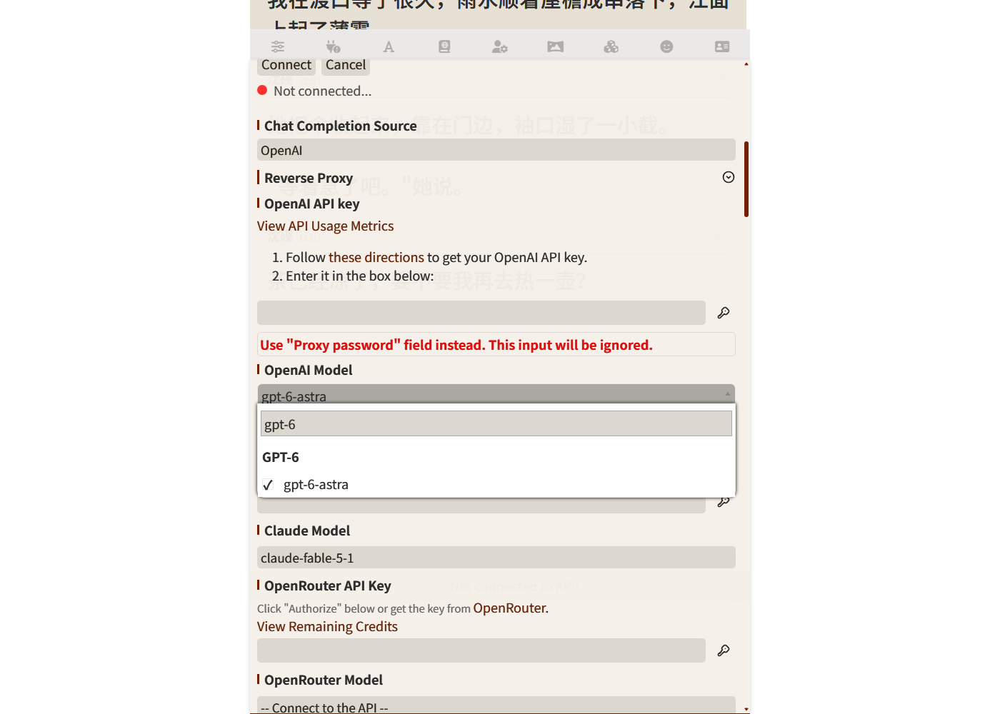
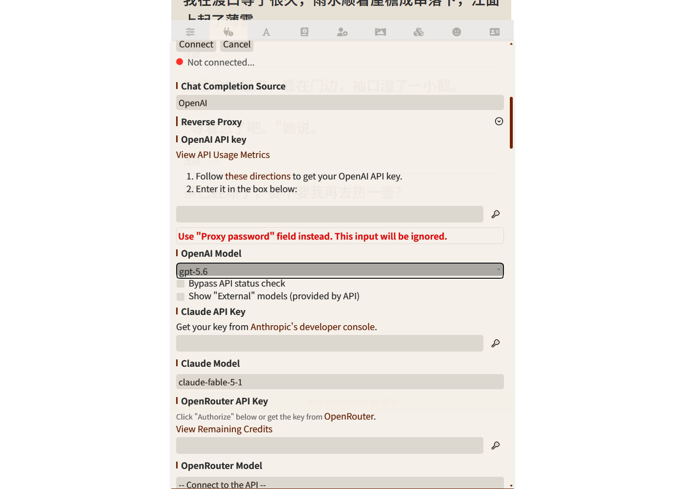
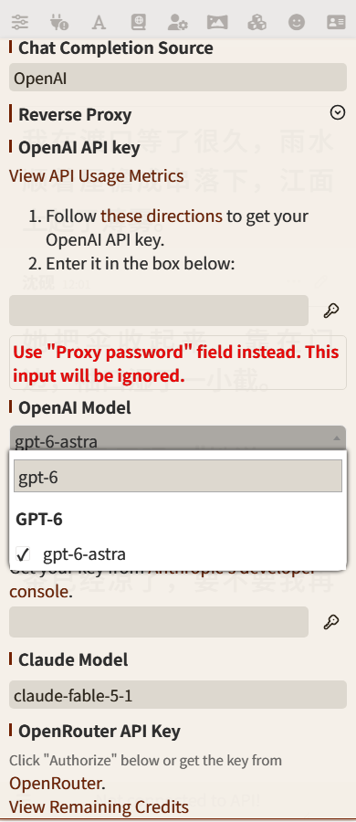

# OpenAI Model Search for SillyTavern

给 SillyTavern 的 **OpenAI Model 下拉**（`#model_openai_select`）补上丢失的**搜索框**。

SillyTavern 自己就内置了 select2（自带搜索），并且已经给 OpenRouter / Aimlapi /
ElectronHub / Chutes / NanoGPT 五个模型下拉挂上了——**唯独漏了 OpenAI 这一个**。
本扩展只补上这一处，不改动任何核心文件。

## 效果

下拉展开后顶部出现搜索框，输入即过滤：



| 展开态 | 手机端 |
|---|---|
|  |  |

## 安装

### 方式一：直接 clone（推荐，方便更新）

```bash
cd <SillyTavern>/public/scripts/extensions/third-party/
git clone https://github.com/<你的账号>/st-openai-model-search.git
```

刷新酒馆页面即可。更新时：

```bash
cd <SillyTavern>/public/scripts/extensions/third-party/st-openai-model-search
git pull
```

### 方式二：手动复制

把本仓库的 `manifest.json` 和 `index.js` 放到：

```
<SillyTavern>/public/scripts/extensions/third-party/st-openai-model-search/
```

然后在酒馆「扩展」面板确认已启用（本地扩展默认启用）。

## 使用

- 打开 **API 连接**（插头图标）→ **Chat Completion** → 展开抽屉 → 点开「OpenAI Model」下拉
- 直接打字过滤，例如 `gpt-6` 只剩 GPT-6 系模型
- 选中后与原生下拉完全一致：设置照常保存、`change` 事件照常触发
- 切换 API / 刷新模型列表后**自动重新接管**，无需刷新页面
- **PC 与手机端均可用**（竖屏 / 横屏实测不溢出视口）

## 实现要点

- **只补官方漏掉的一行**：复用官方 `openai.js` 对 OpenRouter 下拉完全相同的写法
  （`searchInputPlaceholder` + 酒馆输入框样式类 `text_pole`）
- **自包含兜底**：不假设宿主的 `select2-search-placeholder.js` 一定存在，
  挂载时绑 `select2:open`，每次展开自行设置占位符与样式类（重复设置无副作用）
- **幂等**：已挂载则跳过；元素未就绪时在 `APP_READY` 重试
- **动态同步**：用 `MutationObserver` 监听 option 变化（含运行期动态追加的
  External 分组），列表重建后自动 destroy + 重新挂载
- **移动端已启用**：官方 `openai.js` 用 `if (!isMobile())` 跳过 select2（移动端保持原生滚轮），
  本扩展默认在手机端**也启用**搜索，因为模型列表越长，手机上翻找越痛苦。
  如需恢复官方行为，把 `index.js` 顶部的 `ENABLE_ON_TOUCH` 改成 `false` 即可

## 兼容性

| 项目 | 说明 |
|---|---|
| SillyTavern | 基于 `release` 分支 `public/scripts/openai.js` 核对；`loading_order: 999` 保证在宿主初始化后执行 |
| 依赖 | 复用酒馆已加载的 jQuery 与 select2 4.1.0-rc.0，不引入新依赖 |
| 主题/配色 | 跟随酒馆 `select2-overrides.css`，与 OpenRouter 下拉观感一致 |
| 移动端 | 已启用；下拉最大高度取宿主的 300px，竖屏 / 横屏实测均不溢出视口 |

## 已知限制

- **iOS 自动缩放**：Safari 对字号小于 16px 的输入框，聚焦时会整页放大。
  默认配置下搜索框字号为 18px，不受影响；若你把字号调得过小可能触发，
  届时可自行给 `.select2-search__field` 补足 16px。
- 若你的主题对 `.select2-dropdown` 做了特殊覆盖，可能需要在主题侧一并调整。

## 验证

基于「真实 index.html + 宿主全部 CSS + select2 4.1.0-rc.0」的忠实复刻 harness，
4 个场景共 **84 项断言全部通过**：PC 1400 / 手机 390 / 手机 390 触摸 / 手机 844 横屏触摸。
覆盖：搜索框出现、中文占位符、打字过滤、选中后 `val()` 与 `change` 照常、
模型列表动态重建后自动接管、其它 131 个 select 零误伤、下拉不溢出视口。

## 许可

MIT
