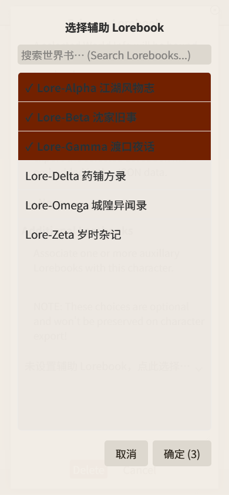

# OpenAI Model Search for SillyTavern

给 SillyTavern 两处下拉补上丢失的**搜索框**：

| # | 下拉 | 元素 | 选择模式 | PC | 手机 / 触摸 |
|---|---|---|---|---|---|
| 1 | Chat Completion 的 **OpenAI Model** | `#model_openai_select` | **单选**（保持不动） | select2 浮层 | 全屏选择弹窗 |
| 2 | 世界书弹窗的 **辅助 Lorebook** | `.character_extra_world_info_selector` | **多选**（保持不动） | select2 浮层（官方已有） | 全屏选择弹窗 |

SillyTavern 自己就内置了 select2（自带搜索）：

- 上游 `public/scripts/openai.js` 已经给 OpenRouter / Aimlapi / ElectronHub /
  Chutes / NanoGPT 五个模型下拉挂上了——**唯独漏了 OpenAI 这一个**。
- 宿主 `script.js:9607` 给「辅助 Lorebook」挂 select2 时写在 `if (!isMobile())` 里，
  于是 **PC 有搜索、移动端没有**。

本扩展只补这两处缺口，不改动任何核心文件。

## 效果

**PC**：下拉展开后顶部出现搜索框，输入即过滤（与 OpenRouter 下拉完全一致的观感）：


**手机**：点下拉位置弹出**全屏选择页**——大号搜索框 + 可滚动列表 + 底部按钮，
触摸目标不小于 44px，比 select2 的小浮层好按得多：

| 模型（单选：点一下即选中并关闭） | 世界书（多选：勾选后点「确定」提交） |
|---|---|
|  |  |

## 安装

### 方式一：直接 clone（推荐，方便更新）

```bash
cd <SillyTavern>/public/scripts/extensions/third-party/
git clone https://github.com/<你的账号>/st-openai-model-search.git
```

刷新酒馆页面即可。更新时：

```bash
cd <SillyTavern>/public/scripts/extensions/third-party/st-openai-model-search
git pull
```

### 方式二：手动复制

把整个文件夹放到：

```
<SillyTavern>/public/scripts/extensions/third-party/st-openai-model-search/
```

然后在酒馆「扩展」面板确认已启用（本地扩展默认启用）。

## 使用

### OpenAI Model 下拉（单选）

- 打开 **API 连接**（插头图标）→ **Chat Completion** → 展开抽屉 → 点「OpenAI Model」
- **PC**：展开 select2 下拉，直接打字过滤，例如 `gpt-6` 只剩 GPT-6 系模型
- **手机**：点那行字弹出全屏选择页，顶部搜索框过滤，**点一项立即选中并关闭**
- 选中后与原生下拉完全一致：设置照常保存、`change` 事件照常触发
- 切换 API / 刷新模型列表后自动跟上（桌面端重新挂 select2；移动端弹窗每次打开
  现读 option，天然同步）
- 两个开关都在 `index.js` 顶部：`ENABLE_ON_TOUCH`（触摸设备是否介入，默认 `true`）、
  `USE_PICKER_ON_TOUCH`（触摸设备是否用全屏弹窗代替 select2，默认 `true`）

### 辅助 Lorebook 下拉（多选）

- 角色编辑 → 世界书弹窗 → **Additional Lorebooks**
- **PC**：官方本来就挂了 select2，本扩展不重复挂载，只补一个中文占位符
- **手机**：点那行字弹出全屏选择页；**保持多选**——点一下勾上/取消（打 ✓），
  「确定 (n)」实时显示已选数量，点确定才一次性提交；「取消」丢弃本次改动
- 重新打开弹窗时已选项会带出来（✓ 标记 + 计数）
- 弹窗关闭再打开是全新 DOM，扩展会持续监听并重新接管，无需刷新

## 实现要点

- **桌面端**：复用官方 `openai.js` 对 OpenRouter 下拉完全相同的写法
  （`searchInputPlaceholder` + 酒馆输入框样式类 `text_pole`）
- **移动端**：select2 的浮层在手机上又小又难点按，改用**原生 `<dialog>` +
  酒馆 `.popup` 系列外观**的全屏选择页：
  - 原生 `<select>` 只是被隐藏，**仍留在 DOM**——宿主 `.val()` 读写与
    `change` 监听全部照常工作
  - 搜索框 `font-size: max(16px, 1em)`，避开 iOS Safari 的聚焦自动放大
  - 列表项 / 按钮触摸目标 ≥44px（横屏矮屏 42px），吸顶分组标题、
    选中项打 ✓、零命中显示「没有匹配项」
  - 单选点一项即提交；多选先暂存、点「确定」一次性 `val(array)` + `change`
- **设备判定**：主判据 `(hover: none) and (pointer: coarse)`；补位判据
  额外要求「窄窗口且**不是**精确指针设备」——Windows 触屏笔记本
  `maxTouchPoints` 也大于 0，不排除的话桌面窗口一拖窄就会误判成移动端
- **幂等 + 防叠加**：已挂 select2 / 已接管的一律跳过；元素未就绪时在 `APP_READY` 重试
- **动态同步**：`MutationObserver` 监听 option 变化（含运行期动态追加的
  External 分组），列表重建后自动重新挂载
- **跳过静态模板**：位于 `.template_element` 里的 Lorebook select **绝不接管**——
  宿主会 clone 它进弹窗，一旦挂了，clone 出来的元素带着标记却没有真控件，
  会**永久失去搜索**

## 兼容性

| 项目 | 说明 |
|---|---|
| SillyTavern | 基于 `release` 分支 `public/scripts/openai.js` / `script.js` 核对；`loading_order: 999` 保证在宿主初始化后执行 |
| 依赖 | 桌面端复用酒馆已加载的 jQuery 与 select2 4.1.0-rc.0；移动端零依赖（原生 `<dialog>`） |
| 主题/配色 | 沿用酒馆 CSS 变量（`--SmartTheme*`），跟随当前主题自动变色 |
| 移动端 | 弹窗在 `<=1000px`（与宿主移动端断点一致）全屏；横屏矮屏自动压缩行高 |

## 已知限制

- iOS Safari 对字号 <16px 的输入框聚焦时会整页放大；本扩展搜索框已守住
  `max(16px, 1em)`，正常字体档位不受影响。
- 移动端弹窗接管后，原生 select 的「滚轮选择器」不再出现——如果你更喜欢
  系统原生滚轮，把 `index.js` 顶部的 `ENABLE_ON_TOUCH` 改成 `false` 即可完全恢复官方行为。

## 验证

基于「真实 index.html + 宿主全部 CSS + select2 4.1.0-rc.0 + 本扩展 style.css」的
忠实复刻 harness，4 个场景共 **260 项断言全部通过**（`PASS 260 / FAIL 0`）：
PC 1400 / 窄窗口 390（非触摸）/ 手机 390 触摸 / 手机 844 横屏触摸。

- **PC select2 路径**：搜索框出现、中文占位符、`text_pole` 样式类、
  打字过滤（真实键盘事件）与清空恢复、零命中不误判（排除 "No results found" 占位行）、
  选中后 `val()` 与 `change` 照常、列表动态重建后自动接管
- **移动端弹窗路径**：不挂 select2、原生 select 隐藏但留 DOM、触发按钮同步显示当前值、
  弹窗全屏、搜索框 ≥16px、触摸目标 ≥44px、打字过滤、零命中空态、
  **单选点一项即提交**（`val()` 更新 + 一次 `change` + 无 DOM 残留）、取消不改值、
  **多选暂存-确认两段式**（连点 3 项只暂存、确定后 `val()` 是长度 3 的数组、
  `multiple` 恒为 true、恰好触发一次 `change`）、重开弹窗带出已选、
  宿主弹窗关闭重开后能重新接管
- **防回归锁**：模型下拉 `multiple` 恒为 false；静态模板零误挂；
  其它 131 个 select 零误伤；收尾无残留弹窗
- 触摸模拟用 `Emulation.setTouchEmulationEnabled`（单发即生效），
  并用断言锁住「触摸模拟是否真的生效」；所有点击走真实鼠标事件且做
  `elementFromPoint` 命中校验，杜绝「点了没点着被当成功能失效」的假阴性

## 许可

MIT
